# Entity-Relationship (ER) Diagram: Rishi Healthcare HMS

## 1. Visual Entity-Relationship Diagram

Below is the complete conceptual and logical Entity-Relationship diagram in standard Mermaid format.

```mermaid
erDiagram
    %% ==========================================
    %% CORE ENTITIES & RELATIONS
    %% ==========================================

    USER {
        int id PK
        string username
        string email UK
        string password
        string role
        string name
        string phone
        string avatar
        datetime createdAt
        datetime updatedAt
    }

    DEPARTMENT {
        uuid id PK
        string name UK
        string code UK
        string description
        string icon
        string headDoctor
        datetime createdAt
        datetime updatedAt
    }

    DOCTOR {
        uuid id PK
        int userId FK,UK
        uuid departmentId FK
        string specialization
        string qualification
        int experienceYears
        float consultationFee
        string roomNo
        string workingHours
        boolean isAvailable
        datetime createdAt
        datetime updatedAt
    }

    PATIENT {
        uuid id PK
        int userId FK,UK
        string patientCode UK
        string name
        string email
        string phone
        datetime dateOfBirth
        int age
        string gender
        string bloodGroup
        string address
        string emergencyContactName
        string emergencyContactPhone
        string allergies
        string chronicConditions
        datetime createdAt
        datetime updatedAt
    }

    APPOINTMENT {
        uuid id PK
        string appointmentNumber UK
        uuid patientId FK
        uuid doctorId FK
        uuid departmentId FK
        datetime appointmentDate
        string timeSlot
        string type
        string status
        string reason
        string symptoms
        string notes
        datetime createdAt
        datetime updatedAt
    }

    MEDICAL_RECORD {
        uuid id PK
        uuid patientId FK
        uuid doctorId FK
        uuid appointmentId FK
        datetime recordDate
        string diagnosis
        string symptoms
        string vitalsBp
        string vitalsPulse
        string vitalsTemp
        string vitalsWeight
        string doctorNotes
        datetime followUpDate
        datetime createdAt
        datetime updatedAt
    }

    PRESCRIPTION {
        uuid id PK
        uuid medicalRecordId FK
        uuid patientId FK
        uuid doctorId FK
        string notes
        datetime createdAt
    }

    PRESCRIPTION_ITEM {
        uuid id PK
        uuid prescriptionId FK
        uuid medicineId FK
        string medicineName
        string dosage
        string frequency
        int durationDays
        string instructions
    }

    MEDICINE {
        uuid id PK
        string code UK
        string name
        string genericName
        string category
        string manufacturer
        string dosageForm
        int stock
        int minStockAlert
        float unitPrice
        datetime expiryDate
        datetime createdAt
        datetime updatedAt
    }

    ROOM {
        uuid id PK
        string roomNumber UK
        int floor
        string roomType
        float dailyRate
        int totalBeds
        datetime createdAt
    }

    BED {
        uuid id PK
        string bedNumber UK
        uuid roomId FK
        string status
        datetime createdAt
    }

    ADMISSION {
        uuid id PK
        string admissionCode UK
        uuid patientId FK
        uuid bedId FK
        uuid attendingDoctorId FK
        datetime admissionDate
        datetime dischargeDate
        string reason
        string status
        string notes
        datetime createdAt
        datetime updatedAt
    }

    BILL {
        uuid id PK
        string invoiceNumber UK
        uuid patientId FK
        uuid appointmentId FK
        uuid admissionId FK
        datetime issueDate
        datetime dueDate
        float subtotal
        float taxRate
        float taxAmount
        float discount
        float totalAmount
        float paidAmount
        string status
        string paymentMethod
        string notes
        datetime createdAt
        datetime updatedAt
    }

    BILL_ITEM {
        uuid id PK
        uuid billId FK
        string description
        string category
        int quantity
        float unitPrice
        float totalPrice
    }

    LAB_TEST {
        uuid id PK
        string testCode UK
        string testName
        string category
        string sampleType
        float cost
        int turnaroundHours
        string description
        datetime createdAt
    }

    LAB_REPORT {
        uuid id PK
        string reportCode UK
        uuid labTestId FK
        uuid patientId FK
        uuid doctorId FK
        datetime testDate
        string resultSummary
        string findings
        string normalRange
        string status
        datetime createdAt
        datetime updatedAt
    }

    %% ==========================================
    %% RELATIONSHIP CARDINALITIES
    %% ==========================================

    USER ||--o| DOCTOR : "authenticates as (1:0..1)"
    USER ||--o| PATIENT : "authenticates as (1:0..1)"

    DEPARTMENT ||--o{ DOCTOR : "employs (1:N)"
    DEPARTMENT ||--o{ APPOINTMENT : "categorizes (1:N)"

    DOCTOR ||--o{ APPOINTMENT : "conducts (1:N)"
    PATIENT ||--o{ APPOINTMENT : "schedules (1:N)"

    PATIENT ||--o{ MEDICAL_RECORD : "subject of (1:N)"
    DOCTOR ||--o{ MEDICAL_RECORD : "records (1:N)"
    APPOINTMENT ||--o| MEDICAL_RECORD : "originates from (0..1:0..1)"

    MEDICAL_RECORD ||--o{ PRESCRIPTION : "generates (1:N)"
    PATIENT ||--o{ PRESCRIPTION : "receives (1:N)"
    DOCTOR ||--o{ PRESCRIPTION : "prescribes (1:N)"

    PRESCRIPTION ||--|{ PRESCRIPTION_ITEM : "contains line items (1:N)"
    MEDICINE ||--o{ PRESCRIPTION_ITEM : "dispensed in (0..1:N)"

    ROOM ||--|{ BED : "contains (1:N)"
    BED ||--o{ ADMISSION : "assigned to (1:N)"
    PATIENT ||--o{ ADMISSION : "admitted as (1:N)"
    DOCTOR ||--o{ ADMISSION : "attending physician for (1:N)"

    PATIENT ||--o{ BILL : "billed to (1:N)"
    APPOINTMENT ||--o| BILL : "billed from OPD (0..1:0..1)"
    ADMISSION ||--o| BILL : "billed from IPD (0..1:0..1)"
    BILL ||--|{ BILL_ITEM : "contains itemized charges (1:N)"

    LAB_TEST ||--o{ LAB_REPORT : "specifies catalog parameters for (1:N)"
    PATIENT ||--o{ LAB_REPORT : "subject of (1:N)"
    DOCTOR ||--o{ LAB_REPORT : "prescribed by (1:N)"
```

---

## 2. Entity Dictionary

| Entity Name | Primary Key | Foreign Keys | Business Description |
|---|---|---|---|
| **User** | `id` (Int, Auto-inc) | None | System authentication credentials, RBAC roles (`ADMIN`, `DOCTOR`, `PATIENT`, `RECEPTIONIST`), and identity profile. |
| **Department** | `id` (UUID) | None | Clinical specialty units (Cardiology, Oncology, Neurosciences, Orthopaedics, etc.). |
| **Doctor** | `id` (UUID) | `userId` (1:1), `departmentId` (N:1) | Credentialed physicians, OPD room numbers, consultation fees, and schedule availability. |
| **Patient** | `id` (UUID) | `userId` (1:1 nullable) | Patient demographics, health ID code (`PAT-1001`), blood group, allergies, and chronic conditions. |
| **Appointment** | `id` (UUID) | `patientId`, `doctorId`, `departmentId` | Scheduled OPD consultation visits with booking slots and approval statuses (`CONFIRMED`, `PENDING`, `COMPLETED`, `CANCELLED`). |
| **MedicalRecord** | `id` (UUID) | `patientId`, `doctorId`, `appointmentId` | Electronic Medical Records (EMR): doctor clinical diagnosis, vitals (BP, pulse, temp, weight), and follow-up plans. |
| **Prescription** | `id` (UUID) | `medicalRecordId`, `patientId`, `doctorId` | Doctor's signed digital prescription order linked to a medical consultation. |
| **PrescriptionItem** | `id` (UUID) | `prescriptionId`, `medicineId` | Itemized medication dosing schedule (medicine name, dosage, frequency, duration in days, instructions). |
| **Medicine** | `id` (UUID) | None | Central pharmacy drug inventory, dosage forms, manufacturer, stock on hand, reorder alerts, and unit prices. |
| **Room** | `id` (UUID) | None | Physical ward rooms, floor locations, room categories (`ICU`, `GENERAL`, `SEMI_PRIVATE`, `DELUXE`), and per-diem rates. |
| **Bed** | `id` (UUID) | `roomId` | Individual hospital beds with real-time operational status (`AVAILABLE`, `OCCUPIED`, `MAINTENANCE`). |
| **Admission** | `id` (UUID) | `patientId`, `bedId`, `attendingDoctorId` | Inpatient hospital admission episode, admitting diagnosis, bed tracking, and discharge timestamp. |
| **Bill** | `id` (UUID) | `patientId`, `appointmentId`, `admissionId` | Official hospital tax invoice, subtotal, 5% GST tax calculation, payment status (`PAID`, `UNPAID`), and payment method. |
| **BillItem** | `id` (UUID) | `billId` | Itemized line items on a hospital bill (Consultation, Bed Accommodation, Pharmacy, Diagnostic Lab). |
| **LabTest** | `id` (UUID) | None | Diagnostic laboratory test master catalog, sample type, standard turnaround time, and price. |
| **LabReport** | `id` (UUID) | `labTestId`, `patientId`, `doctorId` | Executed diagnostic lab report, findings, specimen test date, normal ranges, and clinical signoff. |

---

## 3. Relationship Cardinalities & Business Rules

### 3.1 Authentication & Profile Polymorphism (1:0..1)
- `User` $\to$ `Doctor`: A user may optionally be a doctor (1:0..1). A doctor must map to exactly one user account.
- `User` $\to$ `Patient`: A user may optionally be a patient (1:0..1). Patients can register self-service accounts or be registered as walk-in patients without a user login.

### 3.2 Clinical Consultation & EMR (1:N)
- `Department` $\to$ `Doctor` (1:N): Each department has many doctors; each doctor belongs to exactly one department.
- `Patient` + `Doctor` $\to$ `Appointment` (M:N resolved via associative entity): Patients book multiple appointments with various doctors across dates and slots.
- `Appointment` $\to$ `MedicalRecord` (0..1:0..1): A completed OPD consultation generates at most one diagnostic medical record.
- `MedicalRecord` $\to$ `Prescription` (1:N): A diagnosis can generate one or more clinical prescriptions.
- `Prescription` $\to$ `PrescriptionItem` (1:N): Strong composite ownership—deleting a prescription cascades and removes its items.

### 3.3 Inpatient Admission & Bed Allocation (1:N)
- `Room` $\to$ `Bed` (1:N): A room holds one or more physical beds. Deleting a room removes its beds (`ON DELETE CASCADE`).
- `Bed` $\to$ `Admission` (1:N): Over time, a bed accommodates multiple inpatient admissions, but only one admission has status `ADMITTED` at any single moment.
- `Patient` $\to$ `Admission` (1:N): A patient can have multiple inpatient hospital stays over their lifetime.

### 3.4 Itemized Finance & Tax Invoicing (1:N)
- `Patient` $\to$ `Bill` (1:N): Invoices are issued to the patient.
- `Appointment` $\to$ `Bill` (0..1:0..1): Outpatient consultations link optionally to an OPD invoice.
- `Admission` $\to$ `Bill` (0..1:0..1): Inpatient stays link to an itemized discharge invoice (bed days $\times$ daily rate + medicines + tests).
- `Bill` $\to$ `BillItem` (1:N): Master-detail composition—each invoice has one or more charge items.

### 3.5 Diagnostic Pathology & Radiology (1:N)
- `LabTest` $\to$ `LabReport` (1:N): A standardized test (e.g. *HbA1c*, *Lipid Profile*) is ordered for many patients.
- `Patient` $\to$ `LabReport` (1:N): A patient receives multiple diagnostic reports.
- `Doctor` $\to$ `LabReport` (1:N): A clinician orders and reviews diagnostic lab reports.
